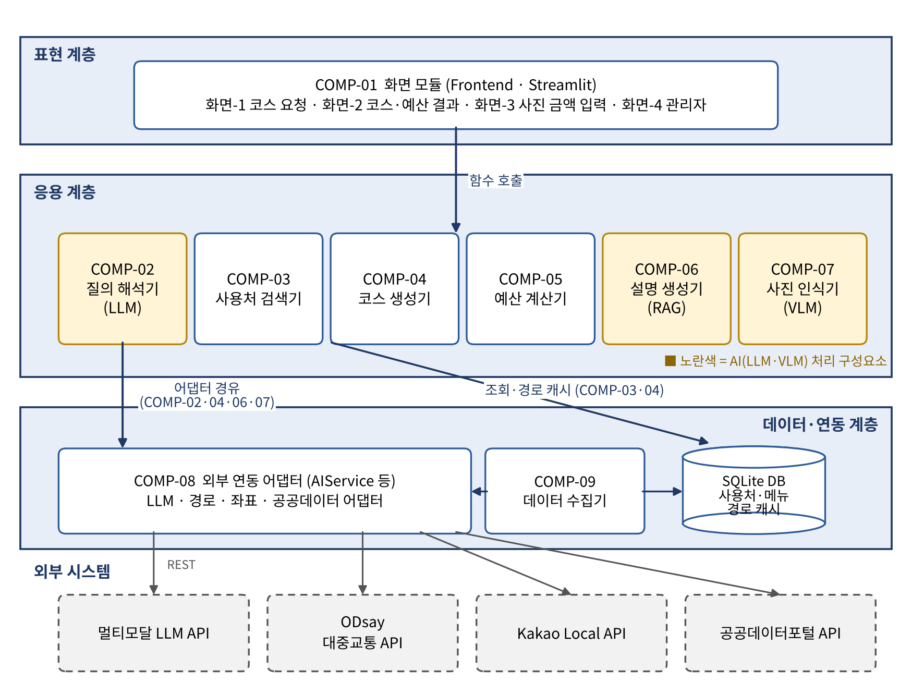

# 부기패스 (BugiPass)

> 부산 사용처·대중교통 AI 예산 안내 서비스
> 동아대학교 소프트웨어공학 02분반 7조 · 담당교수 임한신

"토요일에 서면에서 출발해서 국밥 먹고 근처 한 곳 더, 3만 원 안에서"처럼 **한 문장으로 요청하면**,
AI가 조건을 해석하고 부산 공공데이터에서 사용처를 찾아 **대중교통 코스와 예상 비용(결제액 + 교통비)** 을 알려주는 웹 서비스입니다.
사실 정보(업소·가격·경로)는 공공데이터와 경로 API에서만 가져오고, LLM은 조건 해석과 결과 설명만 담당합니다 (RAG).

## 핵심 기능

| ID | 기능 | AI |
|---|---|---|
| FR-001 | 자연어 코스 요청 (조건 추출 → JSON) | LLM |
| FR-002 | 사용처 검색 및 다중 선택 (최대 3곳) | - |
| FR-003 | 대중교통 코스 생성 및 지도 표시 | - |
| FR-004 | 예산 시뮬레이션 (결제액 + 교통비 → 잔액) | - |
| FR-005 | 영수증·메뉴판 사진 금액 인식 (반복 3) | VLM |
| FR-006 | 근거 기반 AI 설명 + 데이터 출처 표시 | LLM (RAG) |
| FR-007 | 공공데이터 갱신 관리 (관리자) | - |

## 아키텍처



| 폴더 | 컴포넌트 | 설명 |
|---|---|---|
| `app/` | COMP-01 | Streamlit 화면 |
| `services/` | COMP-02 ~ 07 | 질의 해석, 사용처 검색, 코스 생성, 예산 계산, 설명 생성, 사진 인식 |
| `adapters/` | COMP-08 | 외부 API 어댑터 (LLM · ODsay · Kakao · 공공데이터) |
| `data/` | COMP-09 | 공공데이터 수집기와 SQLite DB (DB 파일은 업로드하지 않음) |
| `prompts/` | - | LLM 프롬프트 (버전 관리) |
| `tests/` | - | 단위 시험 (pytest) |
| `docs/` | - | 계획서 · SRS · SDD · UML 다이어그램 |

## 기술 스택

Python 3.11 · Streamlit · streamlit-folium · SQLite · 멀티모달 LLM API · GitHub Actions

## 데이터 및 API 출처

| ID | 데이터/API | 제공처 | 이용 조건 |
|---|---|---|---|
| DATA-01 | 부산광역시_착한가격업소 메뉴 정보 | 공공데이터포털 | 이용허락범위 제한 없음, 출처 표기 |
| DATA-02 | 구·군별 착한가격업소 정보 (주소) | 공공데이터포털 | 출처 표기 |
| DATA-03 | 대중교통 길찾기 | ODsay LAB | 이용약관 준수 |
| DATA-04 | 주소·업소명 → 좌표 변환 | Kakao Local API | 이용약관 준수 |
| DATA-05 | 부산도시철도 역사 정보 | 공공데이터포털 (부산교통공사) | 출처 표기 |
| DATA-06 | 지도 타일 | OpenStreetMap | © OpenStreetMap contributors |

## 실행 방법

```bash
pip install -r requirements.txt
cp .env.example .env        # API 키 입력 (절대 커밋 금지)
streamlit run app/main.py
pytest -q                   # 단위 시험
```

## 팀원 및 역할

| 역할 | 담당 | 주요 업무 |
|---|---|---|
| PM·발표 | (미정) | 일정·이슈 관리, 통합 시험, 발표 |
| AI | (미정) | COMP-02 · 06 · 07, AI 평가 Test Set |
| 데이터·백엔드 | (미정) | COMP-03 · 05 · 09, DB |
| 화면·연동 | (미정) | COMP-01 · 04 · 08, 지도·경로 |

팀원: 전주영, 정재익(팀 대표), 이모하, 이윤서

## 협업 규칙

- 브랜치: `main`(배포) / `feature/요구사항ID` (예: `feature/FR-003`)
- PR: 기능 단위, 팀원 1명 이상 승인 후 병합, 제목에 요구사항 ID 표기
- 이슈: 요구사항 ID 단위로 생성 (`docs/backlog.md` 참고)
- API 키는 `.env`에만 저장 (`.gitignore`로 업로드 차단)

## 문서

- [프로젝트 계획서 v0.2](docs/00_프로젝트_계획서_v0.2.pdf)
- [소프트웨어 요구사항 명세서 (SRS) v0.2](docs/01_SRS_v0.2.pdf)
- [소프트웨어 설계 명세서 (SDD) v0.2](docs/02_SDD_v0.2.pdf)

## 일정

| 반복 | 기간 | 목표 |
|---|---|---|
| 0 | ~10/27 | 분석·설계, 중간 발표 |
| 1 | 10/28 ~ 11/10 | 데이터 수집기·DB, 사용처 검색, 화면 골격 |
| 2 | 11/11 ~ 11/24 | AI 질의 해석, 코스 생성, 예산 계산, 지도 |
| 3 | 11/25 ~ 12/08 | AI 설명(RAG), 사진 인식(VLM), 통합 시험 |
